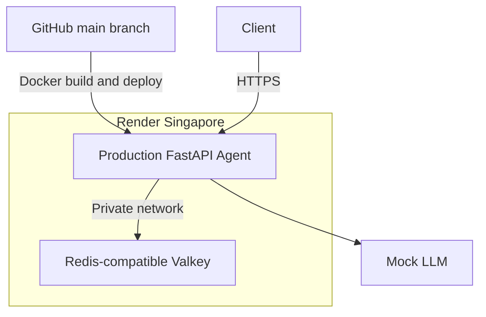

# Deployment Information

## Public URL

https://day14-production-agent-zadu.onrender.com

## Platform

Render Cloud.

| Setting | Value |
|---------|-------|
| Service Name | day14-production-agent |
| Deployment Date | 26/11/2026 |
| Region | Singapore |
| Branch | main |
| Source Commit | 9963514 |
| Root Directory | 06-lab-complete |
| Runtime | Docker |
| Base Image | Python 3.12-slim |
| Docker Image Size (Local Build) | 247 MB |
| Deployment Duration | 1 minute 11 seconds |
| Instance Type | Free |
| CPU | 0.1 CPU |
| RAM | 512 MB |
| Status | Live |

### Redis Configuration

| Setting | Value |
|---------|-------|
| Service Name | day14-redis |
| Runtime | Valkey 8.1.10 |
| Region | Singapore |
| Instance Type | Free |
| Memory | 25 MB |
| Maximum Connections | 50 |
| Maxmemory Policy | noeviction |
| Persistence | Off |
| Connection | Internal private network |
| Status | Available |

## Test Commands

Set the public URL and enter the API key securely:

```bash
BASE="https://day14-production-agent-zadu.onrender.com"
read -rsp "Agent API Key: " AGENT_API_KEY; echo
```

### Health Check

```bash
curl "$BASE/health"
```

Actual result: HTTP 200.

```json
{
  "status": "ok",
  "environment": "production",
  "uptime_seconds": 308.48
}
```

### Readiness Check

```bash
curl "$BASE/ready"
```

Actual result: HTTP 200.

```json
{
  "ready": true,
  "redis_connected": true
}
```

### API Test (without authentication)

```bash
curl -i -X POST "$BASE/ask" \
  -H "Content-Type: application/json" \
  -d '{"question":"Hello"}'
```

Actual result: HTTP 401.

### API Test (with authentication)

```bash
curl -i -X POST "$BASE/ask" \
  -H "X-API-Key: $AGENT_API_KEY" \
  -H "Content-Type: application/json" \
  -d '{"question":"What is Docker?"}'
```

Actual result: HTTP 200.

### Acceptance Test Summary

| Test | Expected | Actual | Result |
|------|----------|--------|--------|
| GET /health | 200 | 200 | PASS |
| GET /ready | 200 | 200 | PASS |
| POST /ask without API key | 401 | 401 | PASS |
| POST /ask with valid API key | 200 | 200 | PASS |

Result: 4/4 PASS.

Verification time: 26/11/2026, 14:44:03 (UTC+7).

Full evidence:
[Cloud deployment verification](evidence/CP6/cloud-deployment.txt)

## Environment Variables Set

| Variable | Configuration |
|----------|---------------|
| PORT | Supplied automatically by Render |
| ENVIRONMENT | production |
| REDIS_URL | Internal Redis URL (secret omitted) |
| AGENT_API_KEY | Generated securely on Render (secret omitted) |
| RATE_LIMIT_PER_MINUTE | 10 |
| DAILY_BUDGET_USD | 1.0 |
| LOG_LEVEL | Not separately configured; application uses INFO |

Secrets are configured through the Render Dashboard and
are not included in this report.

## Screenshots

- [Cloud Redis available](screenshots/CP6-01-cloud-redis.png)
- [Deployment dashboard and running service](screenshots/CP6-02-deployment-success.png)
- [API verification results](screenshots/CP6-03-api-verification.png)

## Architecture



## Deployment Cost and Limitations

- Web Service compute plan: $0/month.
- Redis compute plan: $0/month.
- Total selected compute cost: $0/month.
- The free web service may spin down during inactivity.
- Cold starts may delay the first request.
- Redis disk persistence is disabled.
- Rate limiting and cost tracking state may be lost
  if the Redis instance restarts.
- LLM responses and token costs are simulated.
- The deployment is intended for educational testing,
  not a production SLA.

## Conclusion

The production AI Agent was successfully deployed
to Render using Docker.

All four cloud acceptance tests passed. The agent
is publicly accessible over HTTPS, connects to the
cloud Redis instance, rejects unauthenticated
requests and accepts authenticated requests.

The local production readiness assessment achieved
12/12 criteria and 43/43 individual checks.
