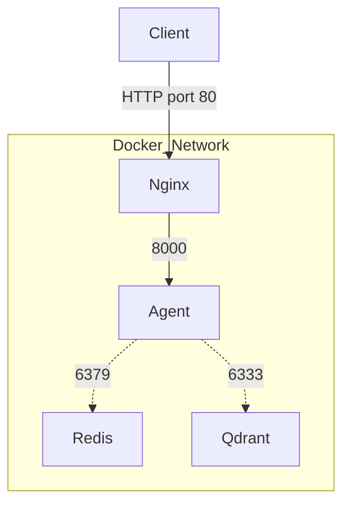
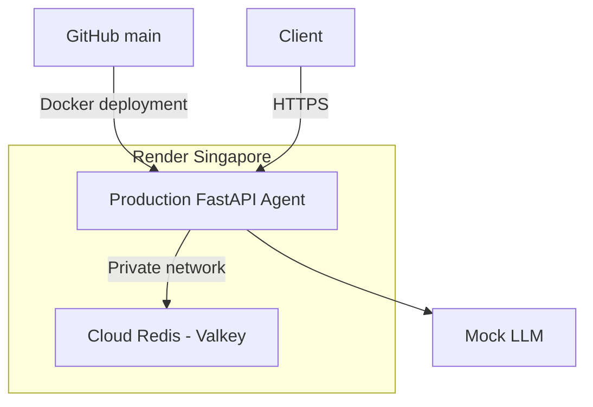
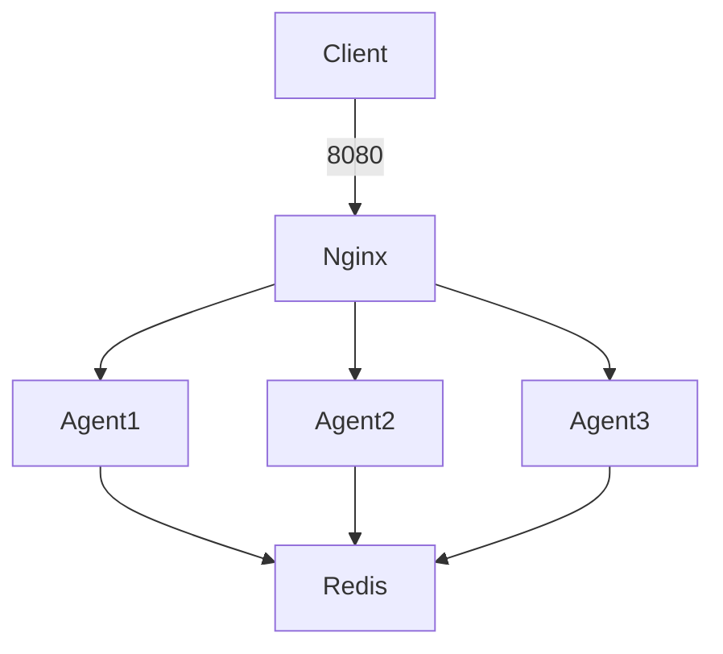

# Day 14 Lab - Mission Answers

> **Student Name:** Nguyễn Tài Minh Huy
> **Student ID:** 2A202603828
> **Date:** 26/11/2026

## Part 1: Localhost vs Production

### Exercise 1.1: Anti-patterns found

1. **Hardcoded API Key:** API key được khai báo trực tiếp trong source code, có nguy cơ bị lộ khi push lên GitHub.
2. **Hardcoded Database URL:** Thông tin kết nối và đăng nhập database nằm trực tiếp trong code.
3. **No Configuration Management:** Các giá trị DEBUG và MAX_TOKENS được cấu hình cố định.
4. **Improper Logging:** Sử dụng print() thay vì structured logging.
5. **Secret Leakage:** API key giả được in trực tiếp ra terminal.
6. **Missing Health Check:** Không có endpoint /health để kiểm tra trạng thái ứng dụng.
7. **Fixed Port:** Port 8000 được hardcode thay vì đọc từ environment variables.
8. **Localhost Binding:** Ứng dụng chỉ lắng nghe trên localhost.
9. **Auto Reload:** reload=True không phù hợp với môi trường production.
10. **Missing Explicit Shutdown Handling:** Không có cơ chế shutdown riêng của ứng dụng.

### Exercise 1.2: Basic version

**Test commands:**

```bash
curl -i -X POST "http://localhost:8000/ask?question=Hello"
curl -i http://localhost:8000/health
```

**Test results:**

| Endpoint | HTTP Status | Result |
|----------|-------------|--------|
| POST /ask | 200 OK | PASS |
| GET /health | 404 Not Found | Expected |

**Actual response:**

```json
{
  "answer": "Agent đang hoạt động tốt! (mock response) Hỏi thêm câu hỏi đi nhé."
}
```

**Observation:**

Basic Agent hoạt động thành công trên localhost:8000.
Tuy nhiên, ứng dụng chưa production-ready vì thiếu health check,
cấu hình bị hardcode và API key giả xuất hiện trong log.

### Exercise 1.3: Comparison table

| Feature | Develop | Production | Why Important? |
|---------|---------|------------|----------------|
| Config | Hardcode | Env vars | Dễ thay đổi cấu hình giữa các môi trường. |
| Health check | Không có | /health | Giúp platform kiểm tra trạng thái ứng dụng. |
| Logging | print() | JSON logging support | Hỗ trợ monitoring và troubleshooting. |
| Shutdown | Không có xử lý riêng | Graceful shutdown | Giúp ứng dụng hoàn tất quá trình shutdown. |
| API Key | Hardcoded | Environment variables | Giảm nguy cơ lộ secret. |
| Port | Fixed 8000 | Configurable | Phù hợp với cloud deployment. |
| Host | localhost | 0.0.0.0 | Cho phép truy cập ngoài localhost. |
| Readiness | Không có | /ready | Kiểm tra khả năng tiếp nhận request. |
| Metrics | Không có | /metrics | Hỗ trợ giám sát ứng dụng. |
| Auto Reload | Always enabled | Configurable | Tránh restart không cần thiết. |

**Production test results:**

| Endpoint | HTTP Status | Result |
|----------|-------------|--------|
| POST /ask | 200 OK | PASS |
| GET /health | 200 OK | PASS |
| GET /ready | 200 OK | PASS |
| GET /metrics | 200 OK | PASS |

- Health status: ok
- Readiness: true
- Application version: 1.0.0
- Environment: development
- LLM: Mock LLM

**Code improvement example:**

Develop:

```python
port=8000
```

Production (config.py):

```python
port: int = field(default_factory=lambda: int(os.getenv("PORT", "8000")))
```

Production đọc port từ environment variables thay vì hardcode.

**Graceful shutdown test:**

```text
INFO: Shutting down
INFO: Waiting for application shutdown.
INFO: Application shutdown complete.
INFO: Finished server process [2594]
```

Ứng dụng hoàn thành shutdown và quay lại terminal.
Tuy nhiên, CancelledError và KeyboardInterrupt xuất hiện
sau khi nhấn Ctrl+C.

Application shutdown thành công, nhưng clean process exit
chưa được xác nhận. SIGTERM sẽ được kiểm tra lại tại Part 6.

## Part 2: Docker

### Exercise 2.1: Dockerfile questions

1. **Base image:** `python:3.11`.
2. **Working directory:** `/app`.
3. **Why COPY requirements.txt first?** Tận dụng Docker Layer Cache để không phải cài lại dependencies mỗi khi application code thay đổi.
4. **CMD vs ENTRYPOINT:** CMD cung cấp lệnh hoặc tham số mặc định có thể ghi đè. ENTRYPOINT xác định chương trình chính được thực thi khi container khởi động.

### Exercise 2.2: Build and run

- Image: `agent-develop:latest`
- Image ID: `4f60fa7fc656`
- Container: `elegant_gagarin`
- Port: 8000
- Build status: PASS
- Container status: Running

| Endpoint | HTTP Status | Result |
|----------|-------------|--------|
| GET /health | 200 OK | PASS |
| POST /ask | 200 OK | PASS |

**Health check response:**

```json
{
  "status": "ok",
  "uptime_seconds": 12.2,
  "container": true
}
```

**Agent response:**

```json
{
  "answer": "Container là cách đóng gói app để chạy ở mọi nơi. Build once, run anywhere!"
}
```

Ban đầu, POST /ask trả về HTTP 422 do gửi JSON body thay vì query parameter. Sau khi sửa lệnh curl, API trả về HTTP 200 OK. Không cần thay đổi source code.

### Exercise 2.3: Image size comparison

- Develop: 1667.79 MB
- Production: 239.82 MB
- Difference: 85.62%

| Metric | Develop | Production |
|--------|---------|------------|
| Build type | Single-stage | Multi-stage |
| Base image | python:3.11 | python:3.11-slim |
| Disk usage | 1.67 GB | 240 MB |
| Content size | 426 MB | 57.4 MB |
| Exact size (bytes) | 1667788194 | 239819288 |

**Stage 1 - Builder:** Cài đặt build tools và Python dependencies.

**Stage 2 - Runtime:** Sao chép dependencies và application code cần thiết từ builder, sử dụng non-root user.

**Why smaller?** Runtime image không chứa các công cụ biên dịch không cần thiết và sử dụng Python slim base image.

**Calculation:**

    (1667788194 - 239819288) / 1667788194 * 100 = 85.62%

### Exercise 2.4: Docker Compose stack

| Service | Image | Status |
|---------|-------|--------|
| Agent | production-agent | Healthy |
| Nginx | nginx:alpine | Running |
| Redis | redis:7-alpine | Healthy |
| Qdrant | qdrant/qdrant:v1.9.0 | Healthy |

**Architecture diagram:**



Nginx đóng vai trò reverse proxy. Các service có thể giao tiếp thông qua Docker internal network. Redis hỗ trợ lưu trữ state và cache; Qdrant hỗ trợ vector storage. Việc sử dụng thực tế Redis và Qdrant chưa được xác minh qua API test này.

**Test results:**

| Endpoint | HTTP Status | Result |
|----------|-------------|--------|
| GET /health | 200 OK | PASS |
| POST /ask | 200 OK | PASS |

**Health check response:**

```json
{
  "status": "ok",
  "uptime_seconds": 52.3,
  "version": "2.0.0",
  "timestamp": "2026-11-26T03:14:05.687414"
}
```

**Security headers observed:**

- X-Frame-Options: DENY
- X-Content-Type-Options: nosniff
- X-XSS-Protection: 1; mode=block

**Result:** All four services started successfully. Both API requests through Nginx returned HTTP 200 OK.

Docker Compose báo cảnh báo version obsolete, nhưng không ảnh hưởng đến quá trình chạy.

## Part 3: Cloud Deployment

### Exercise 3.1 / 3.2: Cloud deployment

#### Selected Cloud Platform

Nền tảng chính được lựa chọn là Render Cloud.
Agent được triển khai từ thư mục 06-lab-complete,
sử dụng Dockerfile production đã đạt 12/12 tiêu chí
và 43/43 checks trong CP5.

| Setting | Actual Value |
|---------|--------------|
| Platform | Render |
| Service | day14-production-agent |
| Region | Singapore |
| Branch | main |
| Source Commit | 9963514 |
| Runtime | Docker |
| Root Directory | 06-lab-complete |
| Deployment Duration | 1 minute 11 seconds |
| Compute Plan | Free |
| CPU | 0.1 CPU |
| RAM | 512 MB |
| Deployment Status | Live |

#### Public URL

https://day14-production-agent-zadu.onrender.com

API Documentation:

https://day14-production-agent-zadu.onrender.com/docs

#### Cloud Redis

| Setting | Actual Value |
|---------|--------------|
| Service | day14-redis |
| Runtime | Valkey 8.1.10 |
| Region | Singapore |
| Memory | 25 MB |
| Maximum Connections | 50 |
| Maxmemory Policy | noeviction |
| Persistence Mode | Off |
| Compute Plan | Free |
| Status | Available |

Agent sử dụng Internal Redis URL để kết nối Redis
qua private network của Render.

Redis lưu trạng thái Rate Limiting và Cost Guard
bên ngoài bộ nhớ của Agent.

Maxmemory Policy noeviction được lựa chọn để
tránh tự động xóa các key đang lưu trạng thái
Rate Limiting và Cost Guard khi bộ nhớ đầy.

#### Environment Variables

| Variable | Configuration |
|----------|---------------|
| PORT | Render platform supplied |
| ENVIRONMENT | production |
| AGENT_API_KEY | Generated on Render |
| REDIS_URL | Internal Redis URL |
| RATE_LIMIT_PER_MINUTE | 10 |
| DAILY_BUDGET_USD | 1.0 |

API Key và Redis URL được cấu hình trực tiếp trên
Render Dashboard, không ghi secret vào source code
hoặc GitHub repository.

#### Cloud Architecture



#### Actual Cloud API Test Results

| Test | Expected | Actual | Result |
|------|----------|--------|--------|
| GET /health | HTTP 200 | HTTP 200 | PASS |
| GET /ready | HTTP 200 | HTTP 200 | PASS |
| POST /ask without API Key | HTTP 401 | HTTP 401 | PASS |
| POST /ask with valid API Key | HTTP 200 | HTTP 200 | PASS |

Result: 4/4 PASS.

Verification time: 26/11/2026, 14:44:03 (UTC+7).

Health Check xác nhận Agent đang hoạt động trong
môi trường production.

Readiness Check xác nhận Agent kết nối được
với Cloud Redis.

Authentication Test xác nhận request không có
API Key bị từ chối và request có API Key hợp lệ
được xử lý thành công.

#### Evidence

- [Deployment report](DEPLOYMENT.md)
- [Cloud API verification](evidence/CP6/cloud-deployment.txt)
- [Cloud Redis](screenshots/CP6-01-cloud-redis.png)
- [Deployment success](screenshots/CP6-02-deployment-success.png)
- [API verification](screenshots/CP6-03-api-verification.png)

#### Railway vs Render Configuration

| Feature | Railway | Render |
|---------|---------|--------|
| Config File | railway.toml | render.yaml |
| Config Format | TOML | YAML |
| Docker Build | builder = DOCKERFILE | runtime: docker |
| Dockerfile | Dockerfile | ./Dockerfile |
| Root Directory | Platform configuration | rootDir: 06-lab-complete |
| Health Check | /health | /health |
| Health Check Timeout | 100 seconds | Platform default |
| Restart Policy | ON_FAILURE | Platform-managed |
| Restart Retries | 3 | Not explicitly configured |
| API Key | Platform variables | generateValue: true |
| Redis URL | Platform variables | sync: false |
| Deployment | Not deployed | Successfully deployed |

Railway sử dụng TOML để mô tả cấu hình build,
health check và restart policy.

Render sử dụng YAML Blueprint để mô tả Web Service,
Docker runtime, root directory và environment variables.

Railway khai báo restart khi gặp lỗi với tối đa
ba lần thử lại. Render configuration hiện tại
không khai báo restart policy riêng.

Render cho phép tự động tạo API Key bằng
generateValue: true và yêu cầu cung cấp Redis URL
bằng sync: false, giúp tránh hardcode secrets.

Cả hai nền tảng đều hỗ trợ Docker và sử dụng PORT
động do platform cung cấp. Vì vậy, application
code không cần thay đổi khi chuyển nền tảng,
nhưng cần cấu hình lại môi trường và Cloud Redis.

Render được chọn làm nền tảng chính cho bài lab
vì có Web Service và Redis-compatible Key Value
với gói compute miễn phí.

Railway được phân tích thông qua configuration,
chưa thực hiện deployment thực tế.

#### Cloud Deployment Limitations

- Web Service Free Plan có thể spin down khi không hoạt động.
- Request đầu tiên sau thời gian không hoạt động có thể gặp cold start.
- Free Redis không hỗ trợ disk persistence.
- Rate Limiting và Cost Guard state có thể mất nếu Redis restart.
- Giữ state sau Agent restart khác với Redis disk persistence.
- Agent sử dụng Mock LLM, không phát sinh chi phí LLM thật.
- Tổng chi phí compute theo hai gói đã chọn là $0/month.
- Chưa kiểm thử cloud failover hoặc production SLA.

### Exercise 3.3: Cloud Run CI/CD pipeline

Dựa trên cloudbuild.yaml và service.yaml:

1. Test: Cloud Build cài dependencies và pytest, sau đó chạy unit tests.
2. Build: Docker image được tạo với hai tag COMMIT_SHA và latest.
3. Push: Docker image được đưa lên container registry.
4. Deploy: Cloud Run triển khai image theo COMMIT_SHA tại asia-southeast1, cấu hình 1-10 instances, 1 CPU, 512 MiB RAM và timeout 60 giây.
5. Service definition: service.yaml khai báo concurrency 80, health/startup probes và secrets lấy từ Google Secret Manager.

Pipeline được thiết kế để tự động chạy khi push
lên main nếu Cloud Build Trigger đã được cấu hình.

Exercise này chỉ phân tích configuration mẫu.
Chưa thực hiện deployment trên Google Cloud Run.

**Cloud Deployment Result: 4/4 Acceptance Tests PASS.**

## Part 4: API Security

### Exercise 4.1-4.3: Test results

#### Exercise 4.1: API Key Authentication

| Test Case | HTTP Status | Result |
|-----------|-------------|--------|
| Missing API Key | 401 Unauthorized | PASS |
| Invalid API Key | 403 Forbidden | PASS |
| Valid API Key | 200 OK | PASS |

API Key Authentication giúp ngăn các request không có thông tin xác thực hoặc sử dụng API Key không hợp lệ.

#### Exercise 4.2: JWT Authentication

| Test Case | Result | Status |
|-----------|--------|--------|
| Generate JWT Token | 168 characters | PASS |
| Request without JWT | 401 Unauthorized | PASS |
| Request with valid JWT | 200 OK | PASS |

JWT được tạo thành công cho tài khoản student.
Client gửi token thông qua Authorization: Bearer header.

Security headers observed:

- X-Content-Type-Options: nosniff
- X-Frame-Options: DENY
- X-XSS-Protection: 1; mode=block
- Referrer-Policy: strict-origin-when-cross-origin

#### Exercise 4.3: Rate Limiting

- User: student
- Rate limit: 10 requests/minute
- Number of requests in the loop: 12
- Successful requests: 9
- Blocked requests: 3

| Requests | HTTP Status | Result |
|----------|-------------|--------|
| Request 1-9 | 200 OK | Accepted |
| Request 10-12 | 429 Too Many Requests | Blocked |

Trước khi chạy vòng lặp, một request JWT đã thành công.
Do đó, tổng số request được chấp nhận là 10,
phù hợp với rate limit của tài khoản student.

Rate Limiting: PASS.

#### Raw HTTP Evidence (Retest)

Thực hiện kiểm tra lại để lưu minh chứng HTTP thực tế.
Kết quả retest được lưu riêng, không thay thế kết quả
thực nghiệm ban đầu.

**Missing JWT - HTTP 401**

```text
HTTP/1.1 401 Unauthorized
date: Thu, 26 Nov 2026 04:45:51 GMT
server: uvicorn
www-authenticate: Bearer
content-length: 76
content-type: application/json
x-content-type-options: nosniff
x-frame-options: DENY
x-xss-protection: 1; mode=block
referrer-policy: strict-origin-when-cross-origin

{"detail":"Authentication required. Include: Authorization: Bearer <token>"}
```

**Valid JWT - HTTP 200**

```text
HTTP/1.1 200 OK
date: Thu, 26 Nov 2026 04:45:51 GMT
server: uvicorn
content-length: 192
content-type: application/json
x-content-type-options: nosniff
x-frame-options: DENY
x-xss-protection: 1; mode=block
referrer-policy: strict-origin-when-cross-origin

{"question":"Explain JWT","answer":"Tôi là AI agent được deploy lên cloud. Câu hỏi của bạn đã được nhận.","usage":{"requests_remaining":9,"budget_remaining_usd":1.9e-05}}
```

**Rate Limit Exceeded - HTTP 429**

```text
HTTP/1.1 429 Too Many Requests
date: Thu, 26 Nov 2026 04:45:52 GMT
server: uvicorn
x-ratelimit-limit: 10
x-ratelimit-remaining: 0
x-ratelimit-reset: 1795668412
retry-after: 59
content-length: 98
content-type: application/json
x-content-type-options: nosniff
x-frame-options: DENY
x-xss-protection: 1; mode=block
referrer-policy: strict-origin-when-cross-origin

{"detail":{"error":"Rate limit exceeded","limit":10,"window_seconds":60,"retry_after_seconds":59}}
```

**Retest results:**

- Successful agent requests: 10.
- Blocked requests: 3.
- Retry-After: 59 seconds.
- Usage tracking: HTTP 200.
- Estimated cost: $0.000186.
- Remaining daily budget: $0.999814.

Full evidence:

[evidence/CP3/api-security.txt](evidence/CP3/api-security.txt)

### Exercise 4.4: Cost guard implementation

#### Current Cost Guard

Kết quả thực nghiệm từ GET /me/usage:

| Metric | Actual Value |
|--------|--------------|
| User ID | student |
| Date | 2026-11-26 |
| Requests | 10 |
| Input tokens | 24 |
| Output tokens | 308 |
| Total tokens | 332 |
| Estimated cost | $0.000188 |
| Daily budget | $1.00 |
| Remaining budget | $0.999812 |
| Budget used | 0.0188% |

API hiển thị budget_used_pct = 0.0 do làm tròn.
Chi phí trên được tính từ Mock LLM, không phải hóa đơn thực tế.

#### Monthly Cost Guard

Implementation file:

    04-api-gateway/production/monthly_cost_guard.py

Function:

    check_budget(user_id: str, estimated_cost: float) -> bool

Implementation logic:

1. Mỗi user có ngân sách $10/tháng.
2. Sử dụng Redis để lưu spending theo từng user và tháng.
3. Redis key có dạng budget:{user_id}:{YYYY-MM}.
4. Kiểm tra spending hiện tại cộng estimated cost.
5. Nếu tổng chi phí vượt $10, trả về False.
6. Nếu còn ngân sách, cập nhật Redis và trả về True.
7. Khi sang tháng mới, sử dụng Redis key mới.
8. Redis key cũ có TTL 32 ngày kể từ lần cập nhật cuối.

#### Redis integration test

- Redis image: redis:7-alpine
- Redis connection: PONG
- Python Redis client: 8.2.0

| Test | Estimated Cost | Total Spending | Allowed | Result |
|------|----------------|----------------|---------|--------|
| 1 | $3.00 | $3.00 | True | PASS |
| 2 | $5.00 | $8.00 | True | PASS |
| 3 | $3.00 | $8.00 | False | PASS |
| 4 | $2.00 | $10.00 | True | PASS |
| 5 | $0.10 | $10.00 | False | PASS |

Actual test output:

    Test 1: cost=$3.00, allowed=True, spending=$3.00 - PASS
    Test 2: cost=$5.00, allowed=True, spending=$8.00 - PASS
    Test 3: cost=$3.00, allowed=False, spending=$8.00 - PASS
    Test 4: cost=$2.00, allowed=True, spending=$10.00 - PASS
    Test 5: cost=$0.10, allowed=False, spending=$10.00 - PASS

    TOTAL: 5/5 PASS

#### Production considerations

Implementation hiện tại đáp ứng các test tuần tự.
Để hỗ trợ concurrent requests trong production,
cần sử dụng Redis Transaction hoặc Lua Script để
đảm bảo atomicity và tránh race condition.

Monthly Cost Guard được triển khai độc lập và chưa
tích hợp vào endpoint /ask của Advanced Agent.

Chưa kiểm tra việc chuyển tháng thực tế, Redis persistence
hoặc concurrent requests.

Original cost_guard.py and existing source code are preserved.

## Part 5: Scaling & Reliability

### Exercise 5.1-5.5: Implementation notes

#### Health Check and Readiness

| Test | Actual Result | Status |
|------|---------------|--------|
| GET /health | HTTP 200 | PASS |
| GET /ready | HTTP 200 | PASS |
| POST /ask | HTTP 200 | PASS |
| Memory check | status: ok | PASS |
| Memory usage | 4.0% | Observed |
| Readiness | true | PASS |
| In-flight requests | 1 | Observed |

Health Check giúp kiểm tra trạng thái hoạt động của Agent.
Readiness Check xác định Agent có sẵn sàng tiếp nhận request hay không.

#### Graceful Shutdown

Gửi hai concurrent requests đến Agent, sau đó gửi
tín hiệu SIGTERM sau 0.5 giây.

**Initial test:**

| Request | Actual Result | Status |
|---------|---------------|--------|
| Request 1 | HTTP 200 | PASS |
| Request 2 | HTTP 000 - Connection reset by peer | FAIL |

Initial result: 1/2 PASS.

**Root cause analysis:**

Endpoint ask_agent() được khai báo async nhưng gọi
hàm ask() đồng bộ. Mock LLM sử dụng time.sleep(),
gây blocking Event Loop.

Blocking operations cũng xuất hiện trong startup
và shutdown lifecycle.

Đây là nguyên nhân có khả năng cao dẫn đến việc
request thứ hai bị ngắt kết nối trong lần test đầu tiên.

#### Implementation Improvement

Modified file:

    05-scaling-reliability/develop/app.py

| Before | After |
|--------|-------|
| import signal | Bổ sung import asyncio |
| time.sleep(0.2) | await asyncio.sleep(0.2) |
| time.sleep(1) | await asyncio.sleep(1) |
| ask(question) | await asyncio.to_thread(ask, question) |

Sử dụng asyncio.to_thread() để thực thi Mock LLM
trong thread riêng, tránh blocking Event Loop.

Giữ nguyên Mock LLM, API endpoints, comments
và TODO của giảng viên.

Python syntax validation: PASS.

#### Graceful Shutdown Retest

| Request | Before Fix | After Fix |
|---------|------------|-----------|
| Request 1 | HTTP 200 | HTTP 200 |
| Request 2 | HTTP 000 | HTTP 200 |
| Successful requests | 1/2 | 2/2 |

**Actual server output:**

    INFO: Shutting down
    INFO: Waiting for connections to close.
    POST /ask?question=hello HTTP/1.1 200 OK
    POST /ask?question=docker HTTP/1.1 200 OK
    INFO: Waiting for application shutdown.
    Graceful shutdown initiated...
    Shutdown complete
    INFO: Application shutdown complete.
    INFO: Finished server process [4612]
    INFO: Received signal 15

Result: 2/2 PASS.

Cả hai requests được hoàn thành trước khi server
kết thúc quá trình shutdown.

Bản sửa giải quyết được lỗi trong lần retest.
Chưa kiểm tra Graceful Shutdown dưới tải lớn.

#### Stateless Agent and Shared Session

Agent được triển khai thành ba instances.
Conversation history được lưu trong Redis thay vì
bộ nhớ riêng của từng instance.

Các requests thuộc cùng một session có thể được
xử lý bởi nhiều Agent instances khác nhau mà vẫn
duy trì đầy đủ lịch sử hội thoại.

#### Docker Compose Scaling

**Command:**

    docker compose up -d --build --scale agent=3

**Actual results:**

| Service | Quantity | Final Status |
|---------|----------|--------------|
| Agent | 3 | Healthy |
| Nginx | 1 | Running |
| Redis | 1 | Healthy |
| Total | 5 | Running |

- Nginx published port: 8080
- Agent internal port: 8000
- Redis internal port: 6379

#### Architecture Diagram



#### Load Balancing Test

**Command:**

    curl -i http://localhost:8080/health

**Actual results:**

- HTTP Status: 200 OK
- Instance ID: instance-8adcf8
- Storage: redis
- Redis connected: true
- X-Served-By: 172.19.0.5:8000

#### Stateless Scaling Test

**Command:**

    python test_stateless.py

| Request | Agent Instance | Result |
|---------|----------------|--------|
| 1 | instance-1883c2 | PASS |
| 2 | instance-745eef | PASS |
| 3 | instance-8adcf8 | PASS |
| 4 | instance-1883c2 | PASS |
| 5 | instance-745eef | PASS |

**Actual results:**

- Total requests: 5
- Successful requests: 5
- Unique instances used: 3
- Total conversation messages: 10
- User messages: 5
- Assistant messages: 5

**Request distribution:**

| Instance | Requests |
|----------|----------|
| instance-1883c2 | 2 |
| instance-745eef | 2 |
| instance-8adcf8 | 1 |

All requests served despite different instances.
Session history preserved across all instances via Redis.

Result: PASS.

#### Docker Cleanup

Tất cả ba Agent instances đều đạt trạng thái healthy
trước khi dừng Docker Compose.

Năm containers và Docker network đã được gỡ bỏ.
Docker images không bị xóa.

Docker cleanup: PASS.

#### Conclusion

Graceful Shutdown được cải thiện bằng asyncio,
giúp tránh blocking Event Loop.

Kết quả kiểm tra cải thiện từ 1/2 PASS lên 2/2 PASS.

Nginx phân phối thành công năm requests đến ba
Agent instances khác nhau.

Redis duy trì đầy đủ 10/10 conversation messages.

Kết quả thực nghiệm xác nhận khả năng Stateless
Scaling, Load Balancing và Shared Session trong
môi trường Docker Compose.

Chưa thực hiện kiểm tra failover, Redis persistence
sau khi restart hoặc benchmark dưới tải lớn.

## Part 6: Final Project

### Production Readiness Checklist

**Verification command:**

```bash
cd 06-lab-complete
python check_production_ready.py
```

**Actual assessment output:**

```text
📋 Checklist Deliverable
     ✅ Dockerfile (multi-stage, < 500 MB)
     ✅ docker-compose.yml (agent + redis)
     ✅ .dockerignore
     ✅ Health check endpoint (GET /health)
     ✅ Readiness endpoint (GET /ready)
     ✅ API Key authentication
     ✅ Rate limiting
     ✅ Cost guard
     ✅ Config từ environment variables
     ✅ Structured logging
     ✅ Graceful shutdown
     ✅ Public URL ready (Railway / Render config)
----------------------------------------------------------------
  Result: 12/12 tiêu chí đạt · 43/43 checks passed
  🎉 PASS 12/12 — PRODUCTION READY! Deploy nào!
```

### Production Readiness Test Results

| Metric | Actual Result | Status |
|--------|---------------|--------|
| Production readiness criteria | 12/12 | PASS |
| Individual checks | 43/43 | PASS |
| Docker image size | 247 MB | PASS |
| Docker build time | 24 seconds | Observed |
| Base image | python:3.12-slim | PASS |
| Uvicorn workers | 2 | PASS |
| Non-root container | Enabled | PASS |
| Health check | HTTP 200 | PASS |
| Readiness without Redis | HTTP 503 | PASS |
| Authentication | HTTP 401 / 200 | PASS |
| Rate limiting | HTTP 429 | PASS |
| Rate limit persistence | Preserved after restart | PASS |
| Cost guard | HTTP 402 | PASS |
| Structured logging | 12 valid JSON lines | PASS |
| Graceful shutdown | Exit code 0 | PASS |
| Docker stop | 1.0 second | PASS |
| Railway configuration | Valid | PASS |
| Render configuration | Valid | PASS |

### Implementation Summary

- Multi-stage Docker build using Python 3.12-slim.
- Non-root runtime container with dynamic PORT.
- FastAPI health and readiness endpoints.
- API key authentication through environment variables.
- Redis sliding-window rate limiting using Lua scripting.
- Redis-backed daily cost tracking and budget enforcement.
- Structured JSON application logging.
- FastAPI lifespan and graceful shutdown.
- Docker Compose integration with Redis.
- Railway and Render deployment configurations.

### Evidence

Full assessment output:

[evidence/CP5/production-readiness.log](evidence/CP5/production-readiness.log)

### Limitations

- The agent uses Mock LLM responses.
- Token usage and costs are estimated.
- Budget reservation for concurrent requests is not implemented.
- Cloud deployment and public URL verification are pending.
- Benchmark and observability testing are pending.

**Final result: PASS 12/12 - PRODUCTION READY.**

## AI Log

| Part | AI Tool | Purpose | Verification |
|------|---------|---------|--------------|
| Setup | ChatGPT | Hướng dẫn cài đặt WSL2, cấu hình Docker và Git để chuẩn bị môi trường thực hành. | Kiểm tra trực tiếp trên Ubuntu và Docker. |
| Part 1 | ChatGPT | Giải thích các anti-pattern, sự khác biệt giữa môi trường Development và Production, hướng dẫn cách kiểm tra API. | Trực tiếp chạy và kiểm tra Basic Agent và Advanced Agent. |
| Part 1 | ChatGPT | Hướng dẫn cách trình bày câu trả lời và tổng hợp kết quả thực nghiệm. | Đối chiếu nội dung báo cáo với kết quả thực tế trên Terminal. |
| Part 2 | ChatGPT | Giải thích Dockerfile, Multi-stage Build, Docker Compose và hướng dẫn cách đo, so sánh kích thước Docker Image. | Trực tiếp build Docker Image, chạy Container và kiểm tra API bằng curl. |
| Part 3 | ChatGPT | Giải thích cách triển khai Docker Agent lên Render, hướng dẫn cấu hình Cloud Redis, environment variables và API testing; hỗ trợ phân tích sự khác biệt giữa Railway, Render và Cloud Run CI/CD pipeline. | Trực tiếp cấu hình và deploy trên Render, kiểm tra 4/4 Cloud API tests, đối chiếu configuration files và lưu evidence. |
| Part 4 | ChatGPT | Giải thích API Key, JWT, Rate Limiting và Cost Guard; hướng dẫn các bước triển khai, kiểm thử và đề xuất code cho Monthly Cost Guard. | Kiểm tra các mã HTTP 401, 403, 200, 429 và thực hiện Redis test với kết quả 5/5 PASS. |
| Part 5 | ChatGPT | Giải thích Graceful Shutdown, Stateless Agent, Load Balancing; hỗ trợ phân tích lỗi Blocking Event Loop và đề xuất cách khắc phục bằng asyncio. | Trực tiếp kiểm thử trước và sau khi sửa lỗi, kết quả cải thiện từ 1/2 lên 2/2 PASS. Kiểm tra 5 requests qua 3 Agent instances và xác nhận 10 messages được duy trì trong Redis. |
| Part 6 | ChatGPT | Giải thích 12 tiêu chí Production Readiness, hướng dẫn thứ tự thực hiện, đề xuất code và cấu hình cho Docker, Redis, API Security, Cost Guard và Graceful Shutdown; hỗ trợ phân tích kết quả kiểm thử. | Trực tiếp triển khai và chạy script chấm bài gốc của giảng viên, đạt 12/12 tiêu chí và 43/43 checks passed. |
| Part 7 - Benchmark | ChatGPT | Giải thích các chỉ số Benchmark, hướng dẫn kiểm thử, phân tích kết quả và đề xuất cải thiện Knowledge Base. | Trực tiếp thực hiện Benchmark và Evaluation, đạt 23/23 câu đúng, zero regression, kiểm chứng Negative và Strict Quality Gate. |
